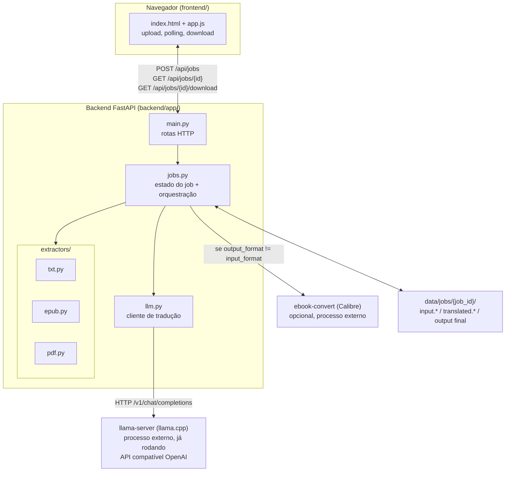

# Arquitetura

## Visão geral

Traduz AI é uma ferramenta local (single-user, roda na máquina do usuário) que traduz livros
inteiros de inglês para português brasileiro, preservando layout, imagens e diagramação. A
tradução é feita por um LLM local servido via `llama-server` (llama.cpp) — não há dependência de
APIs externas pagas.

O sistema é deliberadamente simples: um backend FastAPI (Python) que expõe uma API HTTP mínima, e
um frontend estático (HTML/CSS/JS puro, sem build step) servido pelo próprio backend. Não há
banco de dados — o estado dos jobs vive em memória (`dict` em `jobs.py`) e os arquivos vivem em
disco (`data/jobs/{job_id}/`).



## Componentes

### Backend (`backend/app/`)

| Arquivo | Responsabilidade |
|---|---|
| `main.py` | App FastAPI. 3 rotas (`POST /api/jobs`, `GET /api/jobs/{id}`, `GET /api/jobs/{id}/download`) + serve o `frontend/` como estático em `/`. |
| `config.py` | `pydantic_settings.BaseSettings` com prefixo de env `TRADUZ_`. URL do llama-server, nome do modelo, concorrência, timeouts, idiomas. |
| `jobs.py` | `Job` (dataclass) + `JOBS` (dict em memória, chave = job_id). `create_job()` grava o upload em disco e cria o registro. `run_job()` é a orquestração completa (extrai → traduz → reconstrói → converte formato se necessário). `start_job()` dispara `run_job` como `asyncio.create_task` (fire-and-forget). |
| `llm.py` | `translate_text()` (uma chamada) e `translate_many()` (lista, com concorrência limitada por `asyncio.Semaphore` e callback de progresso). Prompt de sistema fixo instruindo tradução literária EN→PT-BR. |
| `extractors/txt.py` | `TxtDocument` — parágrafos separados por linha em branco. |
| `extractors/epub.py` | `EpubDocument` — usa `ebooklib` + `BeautifulSoup`. Ver [epub-extraction.md](./epub-extraction.md). |
| `extractors/pdf.py` | `PdfDocument` — usa PyMuPDF (`fitz`). É de longe o mais complexo. Ver [pdf-extraction.md](./pdf-extraction.md). |

Cada extractor implementa o mesmo contrato informal (não há uma classe base/Protocol explícita
hoje — ver known-limitations.md):

```python
class XDocument:
    @classmethod
    def load(cls, path: str) -> "XDocument": ...

    # depois de load(): .units é a lista de strings a traduzir, em ordem
    units: list[str]

    def rebuild(self, translations: list[str], output_path: str) -> None: ...
```

`jobs.run_job()` não sabe nada sobre o formato — ele só chama `.load()`, pega `.units`, manda pra
`translate_many()`, e chama `.rebuild()` com o resultado. Isso é o que permite adicionar um novo
formato (ex: `.docx`) só implementando essa interface e registrando em `EXTRACTORS` (jobs.py:20).

### Frontend (`frontend/`)

HTML/CSS/JS estático, sem framework, sem build step. `app.js` faz upload via `FormData`, faz
polling em `GET /api/jobs/{id}` a cada 2s, e mostra o link de download quando `status == "done"`.
Servido pelo próprio FastAPI via `StaticFiles` (`main.py`, montado em `/` — por isso é registrado
**depois** das rotas de API, senão o mount engoliria as requisições).

### Processos externos (não gerenciados pelo backend)

- **`llama-server`**: precisa já estar rodando antes do backend. O backend só faz requisições HTTP
  para `TRADUZ_LLAMA_SERVER_URL` (padrão `http://localhost:8080/v1/chat/completions`). Se o
  modelo estiver "dormindo" (idle timeout do llama-server), a primeira requisição de um job vai
  demorar mais (recarregamento do modelo) — isso já foi observado na prática e não é um bug, é
  esperado.
- **`ebook-convert` (Calibre)**: opcional, só é invocado se o usuário pedir um formato de saída
  diferente do formato de entrada (ex: enviar `.epub`, baixar `.pdf`). Ver `jobs._convert_with_calibre()`.
  Se não estiver instalado, o job termina com `status="done"` e um `warning_message`, entregando o
  arquivo no formato nativo em vez de falhar.

## Modelo de execução / concorrência

- Um único processo Python (`uvicorn`). Jobs rodam como `asyncio.Task`s dentro do mesmo event loop
  do servidor HTTP — não há fila externa (Celery/RQ) nem worker separado.
- `JOBS` é um dict global em memória: **reiniciar o processo do backend perde o estado de todos os
  jobs em andamento** (os arquivos em `data/jobs/` sobrevivem, mas não há como "retomar" um job).
  Aceitável para uma ferramenta local single-user; seria o primeiro ponto a mudar para multi-user
  ou uso em produção (ver known-limitations.md).
- Tradução dentro de um job é paralelizada via `asyncio.Semaphore(TRADUZ_TRANSLATION_CONCURRENCY)`
  (padrão 1). Na prática, contra um `llama-server` local rodando um único slot de inferência,
  aumentar a concorrência não trouxe ganho de velocidade real (testado com concurrency=3 durante o
  desenvolvimento — tempo por bloco não mudou) — o gargalo é a GPU/CPU local, não I/O.

## Layout de diretórios

```
traduz-ai/
├── backend/
│   ├── app/
│   │   ├── main.py
│   │   ├── config.py
│   │   ├── jobs.py
│   │   ├── llm.py
│   │   └── extractors/
│   │       ├── txt.py
│   │       ├── epub.py
│   │       └── pdf.py
│   ├── requirements.txt
│   └── .venv/              (não versionado)
├── frontend/
│   ├── index.html
│   ├── app.js
│   └── style.css
├── data/
│   └── jobs/{job_id}/      (não versionado; input/output de cada job)
└── docs/                   (esta pasta)
```

## Stack e por que essas escolhas

- **Python + FastAPI**: melhores bibliotecas disponíveis para EPUB (`ebooklib`) e PDF (`PyMuPDF`).
  Essa foi a decisão que mais definiu o resto do projeto.
- **Frontend sem framework**: a superfície de UI é pequena (upload, barra de progresso, download) —
  React/Vue seriam complexidade sem benefício aqui.
- **Sem banco de dados**: uso single-user local não justifica persistência além do filesystem.
- **LLM local via llama-server**: decisão explícita do usuário (privacidade/custo zero por uso), em
  vez de Claude/DeepL/Google Translate. Trade-off: qualidade de tradução um pouco abaixo de LLMs
  maiores, e velocidade limitada pelo hardware local (~7-9s por bloco de texto observado com
  `gemma-4-E2B-it` Q8_0 — um livro de 875 páginas / ~7200 blocos levaria ~15h rodando sequencial).
