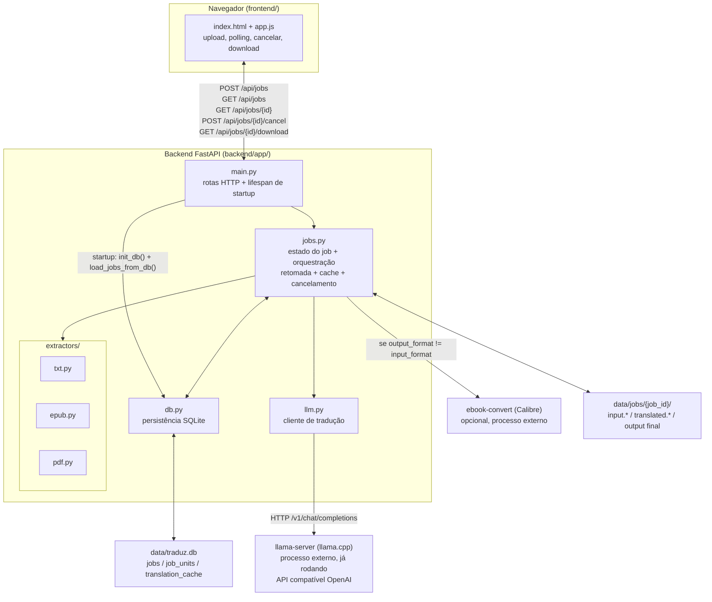

# Arquitetura

## Visão geral

Traduz AI é uma ferramenta local (single-user, roda na máquina do usuário) que traduz livros
inteiros de inglês para português brasileiro, preservando layout, imagens e diagramação. A
tradução é feita por um LLM local servido via `llama-server` (llama.cpp) — não há dependência de
APIs externas pagas.

O sistema é deliberadamente simples: um backend FastAPI (Python) que expõe uma API HTTP mínima, e
um frontend estático (HTML/CSS/JS puro, sem build step) servido pelo próprio backend. O estado dos
jobs vive em memória (`dict` em `jobs.py`) **espelhado em SQLite** (`data/traduz.db`) a cada
transição relevante — a versão em memória é o que a API lê no dia a dia (rápido, sem I/O de disco
por request), o SQLite é o que sobrevive a um restart do processo. Os arquivos de cada job (input
e traduções) vivem em disco em `data/jobs/{job_id}/`.



## Componentes

### Backend (`backend/app/`)

| Arquivo | Responsabilidade |
|---|---|
| `main.py` | App FastAPI. Rotas (`POST /api/jobs`, `GET /api/jobs`, `GET /api/jobs/{id}`, `POST /api/jobs/{id}/cancel`, `GET /api/jobs/{id}/download`) + serve o `frontend/` como estático em `/`. Um `lifespan` de startup chama `db.init_db()` e `jobs.load_jobs_from_db()` antes de aceitar requisições. |
| `config.py` | `pydantic_settings.BaseSettings` com prefixo de env `TRADUZ_`. URL do llama-server, nome do modelo, concorrência, timeouts, idiomas. |
| `models.py` | `Job` (dataclass) — separado de `jobs.py` para que `db.py` possa construir/tipar instâncias sem import circular (`jobs.py` → `db.py` → `jobs.py`). |
| `db.py` | Persistência SQLite (`sqlite3` da stdlib, sem ORM). Ver seção dedicada abaixo. |
| `jobs.py` | `JOBS` (dict em memória, chave = job_id) + `RUNNING_TASKS` (dict de `asyncio.Task`, para permitir cancelamento). `create_job()` grava o upload em disco e persiste no DB. `run_job()` é a orquestração completa (resolve o que já está traduzido/cacheado → traduz o resto → reconstrói → converte formato se necessário). `start_job()` dispara `run_job` como `asyncio.Task` (idempotente: não duplica se já houver uma task rodando para o mesmo job). `cancel_job()`, `list_jobs()`, `load_jobs_from_db()` (retomada automática no startup). |
| `llm.py` | `translate_text()` (uma chamada) e `translate_many()` (lista, com concorrência limitada por `asyncio.Semaphore`, callback agregado `on_progress` e callback por item `on_item_done` — este último é o que `jobs.py` usa para persistir cada tradução incrementalmente). Prompt de sistema fixo instruindo tradução literária EN→PT-BR. |
| `extractors/txt.py` | `TxtDocument` — parágrafos separados por linha em branco. |
| `extractors/epub.py` | `EpubDocument` — usa `ebooklib` + `BeautifulSoup`. Ver [epub-extraction.md](./epub-extraction.md). |
| `extractors/pdf.py` | `PdfDocument` — usa PyMuPDF (`fitz`). É de longe o mais complexo. Ver [pdf-extraction.md](./pdf-extraction.md). |

Cada extractor implementa o mesmo contrato informal (não há uma classe base/Protocol explícita
hoje — ver known-limitations.md):

```python
class XDocument:
    @classmethod
    def load(cls, path: str) -> "XDocument": ...

    # depois de load(): .units é a lista de strings a traduzir, em ordem
    units: list[str]

    def rebuild(self, translations: list[str], output_path: str) -> None: ...
```

`jobs.run_job()` não sabe nada sobre o formato — ele só chama `.load()`, pega `.units`, resolve o
que falta traduzir (ver seção de persistência abaixo) e manda o resto pra `translate_many()`, e
chama `.rebuild()` com o resultado completo. Isso é o que permite adicionar um novo formato (ex:
`.docx`) só implementando essa interface e registrando em `EXTRACTORS` (jobs.py).

### Persistência (`backend/app/db.py`)

SQLite via `sqlite3` da stdlib — sem ORM, sem dependência nova. Cada função de `db.py` abre e
fecha sua própria conexão (curta, com `PRAGMA journal_mode=WAL` e `busy_timeout` aplicados a cada
conexão), em vez de manter uma conexão compartilhada entre threads — mais simples de raciocinar
sobre corretude sob `asyncio.to_thread`, e o custo por chamada é irrelevante perto da latência do
LLM (segundos por chamada).

Três tabelas:

| Tabela | Para quê |
|---|---|
| `jobs` | Metadados do job (status, formato, caminhos, timestamps, `resume_attempts`). **Não** guarda `progress_done`/`progress_total` — isso é recalculado a partir de `job_units` toda vez que um job é carregado, então nunca fica desatualizado mesmo se o processo morrer no meio. |
| `job_units` | Uma linha por trecho de texto do job (`job_id`, índice, texto original, tradução — `NULL` até ser traduzido). É a fonte da verdade para retomada: ao carregar um job, todo índice com tradução não-nula já está pronto e não é reenviado ao LLM. |
| `translation_cache` | Cache **global** (chave = SHA-256 do texto original), compartilhado entre todos os jobs. Um cabeçalho que se repete em 50 páginas do mesmo livro — ou o mesmo texto aparecendo em jobs diferentes — só é traduzido uma vez. |

`jobs.run_job()` usa essas três tabelas juntas: para cada unidade de texto do documento, primeiro
olha se `job_units` já tem uma tradução (retomada de um job específico que morreu no meio);
senão, olha se `translation_cache` já tem uma tradução para aquele texto exato (cache entre jobs);
só o que sobra depois dessas duas checagens vai para `translate_many()`. Conforme cada tradução
nova chega (via `on_item_done`), ela é gravada em ambas as tabelas.

### Frontend (`frontend/`)

HTML/CSS/JS estático, sem framework, sem build step. `app.js` faz upload via `FormData`, faz
polling em `GET /api/jobs/{id}` a cada 2s, mostra um botão "Cancelar" enquanto o job está em
andamento (chama `POST /api/jobs/{id}/cancel`), e mostra o link de download quando `status ==
"done"`. Servido pelo próprio FastAPI via `StaticFiles` (`main.py`, montado em `/` — por isso é
registrado **depois** das rotas de API, senão o mount engoliria as requisições).

**Cuidado de CSS a preservar**: `style.css` tem uma regra `[hidden] { display: none !important; }`
que existe por um motivo não-óbvio — qualquer elemento com sua própria regra de `display` (como
`.button { display: block; }`) faz o navegador **ignorar silenciosamente** o atributo `hidden`,
porque estilos de autor sempre vencem o `[hidden] { display: none }` padrão do user-agent,
independente de especificidade. Isso foi um bug real, confirmado visualmente (o botão "Cancelar"
continuava aparecendo depois do job terminar) antes dessa regra existir. Se remover essa regra,
qualquer botão/link com `hidden` + uma classe que define `display` volta a vazar.

### Processos externos (não gerenciados pelo backend)

- **`llama-server`**: precisa já estar rodando antes do backend. O backend só faz requisições HTTP
  para `TRADUZ_LLAMA_SERVER_URL` (padrão `http://localhost:8080/v1/chat/completions`). Se o
  modelo estiver "dormindo" (idle timeout do llama-server), a primeira requisição de um job vai
  demorar mais (recarregamento do modelo) — isso já foi observado na prática e não é um bug, é
  esperado.
- **`ebook-convert` (Calibre)**: opcional, só é invocado se o usuário pedir um formato de saída
  diferente do formato de entrada (ex: enviar `.epub`, baixar `.pdf`). Ver `jobs._convert_with_calibre()`.
  Se não estiver instalado, o job termina com `status="done"` e um `warning_message`, entregando o
  arquivo no formato nativo em vez de falhar.

## Modelo de execução / concorrência

- Um único processo Python (`uvicorn`). Jobs rodam como `asyncio.Task`s dentro do mesmo event loop
  do servidor HTTP — não há fila externa (Celery/RQ) nem worker separado.
- **Retomada automática no startup**: o `lifespan` de `main.py` chama `jobs.load_jobs_from_db()`,
  que repopula `JOBS` a partir do SQLite e **reinicia automaticamente** qualquer job que ficou em
  um status não-terminal (o processo morreu no meio) — sem ação manual do usuário. Um contador
  `resume_attempts` evita loop infinito: depois de `MAX_RESUME_ATTEMPTS` (3) tentativas de retomada
  automática sem chegar a um status terminal, o job é marcado `error` em vez de reiniciado de novo.
- **Cancelamento**: `start_job()` guarda o `asyncio.Task` em `RUNNING_TASKS`; `cancel_job()` chama
  `.cancel()` nele. `run_job()` captura `asyncio.CancelledError` e grava `status="cancelled"` (não
  gera exceção não tratada). `start_job()` é idempotente — chamar de novo para um job que já tem
  uma task viva em `RUNNING_TASKS` é um no-op, o que importa porque `load_jobs_from_db()` só deve
  rodar uma vez, mas nada impede tecnicamente uma segunda chamada.
- Tradução dentro de um job é paralelizada via `asyncio.Semaphore(TRADUZ_TRANSLATION_CONCURRENCY)`
  (padrão 1). Na prática, contra um `llama-server` local rodando um único slot de inferência,
  aumentar a concorrência não trouxe ganho de velocidade real (testado com concurrency=3 durante o
  desenvolvimento — tempo por bloco não mudou) — o gargalo é a GPU/CPU local, não I/O.

## Layout de diretórios

```
traduz-ai/
├── backend/
│   ├── app/
│   │   ├── main.py
│   │   ├── config.py
│   │   ├── models.py
│   │   ├── db.py
│   │   ├── jobs.py
│   │   ├── llm.py
│   │   └── extractors/
│   │       ├── txt.py
│   │       ├── epub.py
│   │       └── pdf.py
│   ├── requirements.txt
│   ├── requirements-dev.txt
│   └── .venv/              (não versionado)
├── frontend/
│   ├── index.html
│   ├── app.js
│   └── style.css
├── data/
│   ├── jobs/{job_id}/      (não versionado; input/output de cada job)
│   └── traduz.db           (não versionado; estado persistente dos jobs)
└── docs/                   (esta pasta)
```

## Stack e por que essas escolhas

- **Python + FastAPI**: melhores bibliotecas disponíveis para EPUB (`ebooklib`) e PDF (`PyMuPDF`).
  Essa foi a decisão que mais definiu o resto do projeto.
- **Frontend sem framework**: a superfície de UI é pequena (upload, barra de progresso, cancelar,
  download) — React/Vue seriam complexidade sem benefício aqui.
- **SQLite via stdlib, sem ORM**: uso single-user local não justifica um banco externo
  (Postgres/MySQL) nem a complexidade de um ORM assíncrono (`aiosqlite`/SQLAlchemy async) — um
  arquivo `.db` e funções simples com conexões curtas resolvem o problema real (sobreviver a um
  restart) sem dependência nova.
- **LLM local via llama-server**: decisão explícita do usuário (privacidade/custo zero por uso), em
  vez de Claude/DeepL/Google Translate. Trade-off: qualidade de tradução um pouco abaixo de LLMs
  maiores, e velocidade limitada pelo hardware local (~7-9s por bloco de texto observado com
  `gemma-4-E2B-it` Q8_0 — um livro de 875 páginas / ~7200 blocos levaria ~15h rodando sequencial;
  o cache de tradução e a retomada existem justamente para tornar essa restrição administrável).
