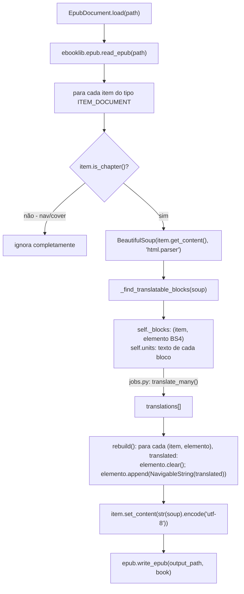

# Extração e Reconstrução de EPUB

`backend/app/extractors/epub.py` — bem mais simples que o pipeline de PDF, porque EPUB é
essencialmente HTML/XHTML dentro de um zip: um documento estruturado, não coordenadas absolutas.

## Algoritmo



## Por que pular o documento de navegação (`is_chapter() == False`)

**Bug encontrado e corrigido durante o desenvolvimento**: a primeira versão iterava por **todos**
os `ITEM_DOCUMENT`, incluindo o `nav.xhtml` (sumário/TOC do e-reader, gerado pelo `ebooklib`). O
sumário tem estrutura `<li><a href="capitulo.xhtml">Capítulo 1</a></li>` — como `<li>` está na
lista de tags traduzíveis (`BLOCK_TAGS`), o código extraía o texto do link ("Capítulo 1"),
traduzia, e depois fazia `elemento.clear()` seguido de `elemento.append(NavigableString(...))` —
isso **apaga o `<a href=...>` e substitui por texto puro**, destruindo o link de navegação do
sumário. O e-reader perdia a capacidade de pular para o capítulo.

**Correção**: `item.is_chapter()` (método do `EpubHtml`/`EpubNav` do `ebooklib`) retorna `False`
para o documento de navegação e para páginas de capa. Filtrar por isso no início do loop
(`epub.py`, dentro de `__init__`) resolve — o sumário do e-reader continua intacto e funcional,
só não é traduzido (ele reflete os títulos de capítulo, que teoricamente já deveriam estar em
inglês no restante do livro se o usuário não traduzir todos os capítulos de uma vez).

## `_find_translatable_blocks` — que elementos viram unidades de tradução

```python
BLOCK_TAGS = ["p", "li", "h1"..."h6", "dt", "dd", "blockquote", "td", "th", "caption", "figcaption"]
```

Regras (`epub.py`):
1. Um elemento só é candidato se for uma dessas tags.
2. **Não pode estar aninhado dentro de outro candidato** (`el.find_parent(BLOCK_TAGS)`) — evita
   traduzir o mesmo texto duas vezes (ex: um `<p>` dentro de um `<li>` seria pego pelo `<li>` pai).
3. **Não pode conter ``, `<svg>` ou `<table>`** — blocos com esses filhos são pulados
   inteiramente. Substituição de texto plano destruiria a imagem/tabela embutida.
4. Texto vazio (só espaços) é descartado.

## Trade-off deliberado: formatação inline é perdida

`elemento.clear()` remove **todos os filhos** do elemento (mantém atributos como `class`/`id`, que
preservam o CSS), e o texto traduzido entra como um único `NavigableString`. Isso significa que
`<p>texto com <b>negrito</b> no meio</p>` vira `<p>texto traduzido inteiro sem negrito</p>` — a
tag `<p>` (e seu CSS) sobrevive, mas formatação **inline** (negrito, itálico, links dentro do
texto corrido, notas de rodapé embutidas) é achatada para texto plano.

Isso foi uma escolha consciente de escopo, não um bug: traduzir preservando formatação inline
exigiria alinhar segmentos de texto entre original e tradução preservando os limites das tags
internas — não confiável com tradução por LLM (a ordem das palavras muda entre idiomas). O
trade-off aceito: perde-se negrito/itálico/links no meio de frases, mas mantém-se a estrutura de
blocos (parágrafos, títulos, listas, tabelas) e CSS/imagens 100% intactos.

## Diferença de robustez em relação ao PDF

EPUB não sofre nenhum dos 5 bugs documentados em [pdf-extraction.md](./pdf-extraction.md) — não
há coordenadas fixas, não há "caber na caixa", o HTML flui naturalmente e o navegador/e-reader do
usuário é quem faz o reflow. Por isso o EPUB é o formato de maior fidelidade e menor risco do
sistema hoje.
