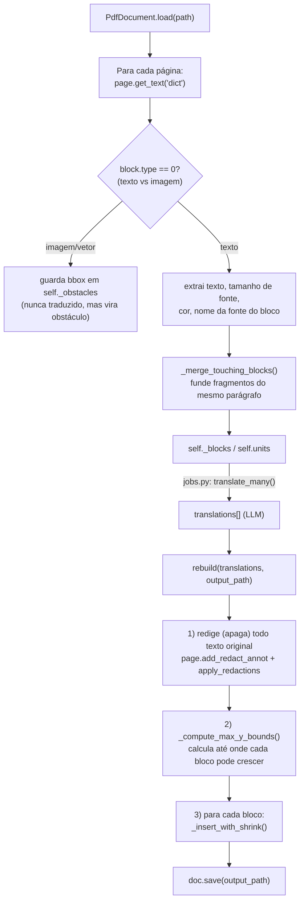
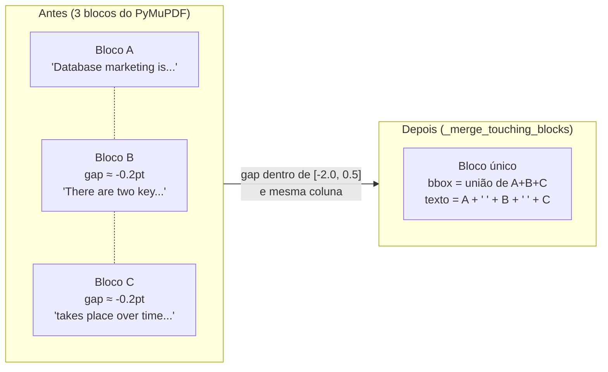
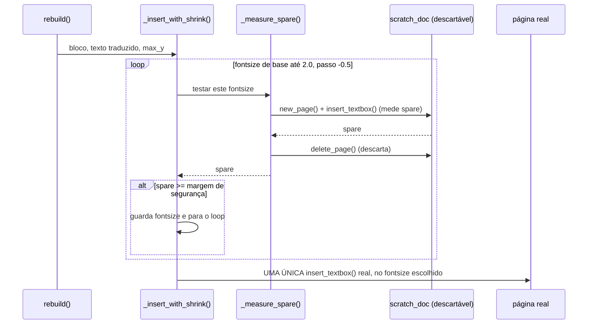

# Extração e Reconstrução de PDF

Este é o componente mais frágil e mais retrabalhado do sistema (`backend/app/extractors/pdf.py`).
PDF não tem noção de "parágrafo" ou "documento" — é uma coleção de instruções de desenho posicionadas
por coordenadas absolutas. Traduzir "no lugar" significa: apagar o texto original de uma região e
desenhar o texto traduzido na mesma região, sem quebrar o resto da página.

Cada seção abaixo documenta um bug real, **confirmado visualmente** (renderizando páginas como PNG
e inspecionando), não hipotético. Todos foram encontrados traduzindo o mesmo capítulo de um livro
real (~875 páginas, livro acadêmico de marketing) ao longo de 5 rodadas de correção. Se você for
mexer neste arquivo, valide do mesmo jeito: **rode `page.get_pixmap()` e olhe a imagem**, não
confie em "rodou sem erro".

## Visão geral do algoritmo



## Os 5 bugs (em ordem de descoberta)

### 1. Pontuação tipográfica virando `?`

**Sintoma**: aspas curvas (`" "`), travessões (`–` `—`), bullet (`•`) e reticências (`…`)
renderizavam como `?` no PDF de saída.

**Causa**: as fontes base-14 do PyMuPDF (`helv`, `hebo`, `heit`, `hebi`) usadas para desenhar texto
novo codificam em **Latin-1 (ISO-8859-1)**, que não tem glifos na faixa `0x80-0x9F` — exatamente
onde essa pontuação "esperta" vive no Windows-1252/Unicode. Acentos em português (á, ç, ã, õ...)
**não** são afetados, porque esses caracteres existem no Latin-1.

**Correção**: `_TYPOGRAPHIC_CHAR_MAP` (topo de `pdf.py`) — tradução explícita para equivalentes
ASCII antes de inserir. Também cobre símbolos matemáticos comuns (`×`, `÷`, `≥`, `≤`, `Π`, `π`, `Σ`,
`−` o sinal de menos U+2212, distinto do hífen) encontrados numa fórmula do livro de teste. Existe
um catch-all no final de `_sanitize_for_pdf_font()`: qualquer caractere fora do Latin-1 que não
esteja no mapa vira `*` (visível, para diferenciar de um `?` real do texto original, e para ficar
óbvio nos testes que algo não foi mapeado).

**Se for adicionar suporte a outro idioma/símbolo**: adicione ao dict `_TYPOGRAPHIC_CHAR_MAP`. Se
aparecerem muitos `*` em livros reais, considere trocar a estratégia por fontes TrueType Unicode
embutidas (ver [known-limitations.md](./known-limitations.md)).

### 2. Texto sumindo silenciosamente em caixas de uma linha só

**Sintoma**: cabeçalhos de página e legendas de tabela (caixas de texto originalmente com altura de
uma linha só) simplesmente desapareciam no PDF traduzido — nem o texto original, nem o traduzido.

**Causa**: `page.insert_textbox()` do PyMuPDF é **tudo ou nada**: se o texto não cabe na caixa dada
no tamanho de fonte pedido, ele **não desenha absolutamente nada** — nem clipa, nem trunca. Um
cabeçalho com pouquíssima folga vertical, ao ser traduzido para um texto ligeiramente mais longo,
deixava de caber mesmo no tamanho mínimo de fonte tentado, e sumia.

**Correção inicial** (substituída depois, ver bug 5): a caixa era "esticada" para baixo até caber.
Essa abordagem específica foi abandonada, mas o princípio continua: **nunca aceitar que nada seja
desenhado** — sempre garantir que ao menos uma tentativa final aconteça.

### 3. Sobreposição entre fragmentos do mesmo parágrafo

**Sintoma**: um parágrafo mais longo (tradução PT-BR ~20-30% maior que o EN original) sobrepunha
visualmente o próximo trecho de texto na mesma página — texto embaralhado, ilegível.

**Causa raiz**: o `get_text("dict")` do PyMuPDF às vezes divide **um único parágrafo visual** em
vários "blocks" consecutivos (ex: por causa de uma referência inline como "Fig. 1.1" que muda de
fonte no meio da frase). Esses fragmentos ficam **encostados** (gap ≈ -0.2pt, medido no documento
de teste) — não há espaço em branco real entre eles, ao contrário de uma quebra de parágrafo/título
de verdade (gap ≥ 0.5pt, tipicamente 10-30pt). Cada fragmento, tratado como bloco de tradução
independente, tinha exatamente **zero folga** para crescer sem invadir o próximo — e qualquer
tradução mais longa que o original causava a sobreposição.

Essa hipótese foi confirmada estatisticamente: extraindo o gap vertical entre todos os pares de
blocos consecutivos do livro de teste inteiro (~7000 blocos), havia um pico isolado em torno de
`-0.2pt` (fragmentos artificiais) claramente separado da distribuição de gaps reais de
parágrafo/título (que começa em `+0.5pt`).

**Correção**: `_merge_touching_blocks()` + `_should_merge()`. Antes de virarem unidades de
tradução, blocos consecutivos na mesma coluna (sobreposição horizontal ≥ 50% da largura do mais
estreito) com gap vertical entre `_MERGE_GAP_MIN = -2.0` e `_MERGE_GAP_MAX = 0.5` são fundidos em
um único bloco (bbox = união, texto concatenado com espaço, fonte = média). Isso dá ao bloco
fundido a altura total original do parágrafo inteiro para a tradução se ajustar, em vez de cada
fragmento ter que caber sozinho no seu pedacinho original.



**Limite escolhido (`-2.0` a `0.5`) é deliberadamente apertado.** Um limite mais largo fundiria
parágrafos genuinamente distintos (perdendo a formatação de indentação entre eles — aceitável) mas
arriscaria fundir através de títulos/legendas reais que por coincidência têm gap pequeno. Se este
limite precisar ser recalibrado para outro documento, repita a análise estatística de gaps antes de
mudar o número às cegas.

### 4. Símbolos matemáticos/gregos — ver bug 1

(Descoberto junto com o bug 1, mesma causa raiz — Latin-1. Documentado ali.)

### 5. `insert_textbox` desenha imediatamente e cumulativamente (o bug mais sutil)

**Sintoma**: mesmo depois de corrigir os bugs 1-3, sobreposição **voltava a acontecer** em blocos
longos (ex: uma lista de 7 itens com marcadores), e um parágrafo curto em outra página **sumia**
de novo — de forma aparentemente incoerente com as correções já feitas.

**Causa raiz (a mais contraintuitiva)**: `page.insert_textbox()` **não é uma função de medição** —
toda chamada desenha de verdade no conteúdo da página, imediatamente, e as chamadas se acumulam.
Confirmado empiricamente:

```python
rect = fitz.Rect(50, 50, 300, 150)
page.insert_textbox(rect, "primeira tentativa", fontsize=12, fontname="helv")
page.insert_textbox(rect, "segunda tentativa", fontsize=10, fontname="helv")
# resultado: AMBOS os textos aparecem, sobrepostos, na mesma região.
```

O algoritmo original (rounds 1-4) tentava tamanhos de fonte decrescentes **chamando
`insert_textbox` de novo a cada tentativa até o retorno (`spare`) ser `>= 0`**. Isso funcionava
*na maioria* dos casos porque uma tentativa com `spare < 0` normalmente não desenha nada (ver bug
2) — mas havia uma zona cinzenta: tentativas com `spare` **ligeiramente positivo** (ex: `+2.9pt`
de sobra calculada) **desenhavam texto que na prática ultrapassava visualmente a caixa dada em
dezenas de pontos** — ou seja, `spare >= 0` não é garantia confiável de que o desenho respeitou os
limites da caixa. Quando o algoritmo antigo não gostava desse resultado (`spare` positivo mas
abaixo de uma margem de segurança) e tentava de novo com fonte menor, a segunda chamada desenhava
**por cima** da primeira — som duplicado/deslocado, lido como "sobreposição".

**Correção**: `_measure_spare()` cria uma **página descartável num documento de rascunho**
(`self._scratch_doc`, criado uma vez em `__init__`) para testar cada tamanho de fonte, sem nunca
tocar a página real. Só depois de decidir o tamanho final (o primeiro que atinge uma margem de
segurança, ou o melhor encontrado como fallback) é que **uma única chamada** de `insert_textbox`
acontece na página de verdade, dentro de `_insert_with_shrink()`.



A margem de segurança (`margin = max(4.0, altura_da_caixa * 0.08)`) existe justamente porque
`spare >= 0` sozinho já provou não ser confiável — exige-se folga real, não só "tecnicamente
positivo".

## `_compute_max_y_bounds()` — nunca crescer para cima do próximo conteúdo

Independente do tamanho de fonte escolhido, um bloco nunca deve desenhar além de:
1. O topo do **próximo bloco de texto** abaixo dele, na mesma coluna (sobreposição horizontal > 0).
2. O topo da **próxima imagem/figura** abaixo dele (blocos `type != 0`, guardados em
   `self._obstacles` — sem isso, uma legenda de tabela mais longa cresce por cima da própria
   tabela).
3. O fundo da página (`page.rect.height - 18`, uma margem de segurança fixa).

O menor desses três vira `max_y` para aquele bloco; `_insert_with_shrink()` recebe esse valor e
nunca usa uma caixa que ultrapasse `max_y - 4` (mais 4pt de colchão).

**Limitação conhecida**: esse cálculo assume layout de **coluna única**. Para PDFs em múltiplas
colunas, a heurística de "sobreposição horizontal = mesma coluna, portanto candidato a vizinho
abaixo" pode escolher o bloco errado como limite. Não testado contra PDFs multi-coluna — ver
known-limitations.md.

## Redação (apagar o texto original)

`rebuild()` primeiro adiciona uma anotação de redação (`add_redact_annot`, preenchimento branco
`(1,1,1)`) em **todos** os blocos de texto de uma vez, depois aplica (`apply_redactions()`) por
página. Isso efetivamente remove o conteúdo de texto original do stream do PDF (não é só "pintar
por cima" — `apply_redactions` de fato deleta os operadores de desenho de texto na região). Duas
implicações:

- O preenchimento é sempre branco `(1,1,1)`. Se a página tiver fundo colorido/texturizado atrás do
  texto (incomum em livros, mas existe em alguns designs), a região redigida vai destoar.
- Imagens e vetores (`type != 0`) nunca são tocados pela redação — só bboxes de blocos de texto.

## Resumo das constantes ajustáveis

| Constante | Valor | Efeito de aumentar/diminuir |
|---|---|---|
| `MIN_FONTSIZE` / piso real usado (`2.0` no loop de shrink) | `2.0`pt | Piso absoluto de shrink. Textos que só cabem abaixo disso ficam ilegíveis mas nunca são perdidos. |
| `FONTSIZE_STEP` | `0.5`pt | Granularidade do shrink. Menor = mais preciso, mais chamadas de medição (mais lento). |
| `_MERGE_GAP_MIN` / `_MERGE_GAP_MAX` | `-2.0` / `0.5` pt | Janela de gap vertical para considerar dois blocos como fragmentos do mesmo parágrafo. Ver bug 3. |
| margem de segurança em `_insert_with_shrink` | `max(4.0, altura*0.08)` | Quão conservador é o critério de "cabe de verdade". Menor = mais fiel ao tamanho de fonte original, mas mais arriscado de reproduzir o bug 5. |
| margem antes do próximo bloco (`max_y - 4`) | `4`pt | Colchão de segurança contra o próximo bloco/imagem. |
| margem antes do fim da página (`page.rect.height - 18`) | `18`pt | Colchão de segurança contra a borda da página. |
