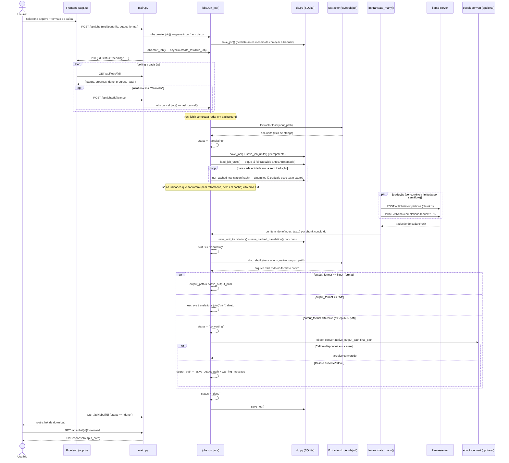
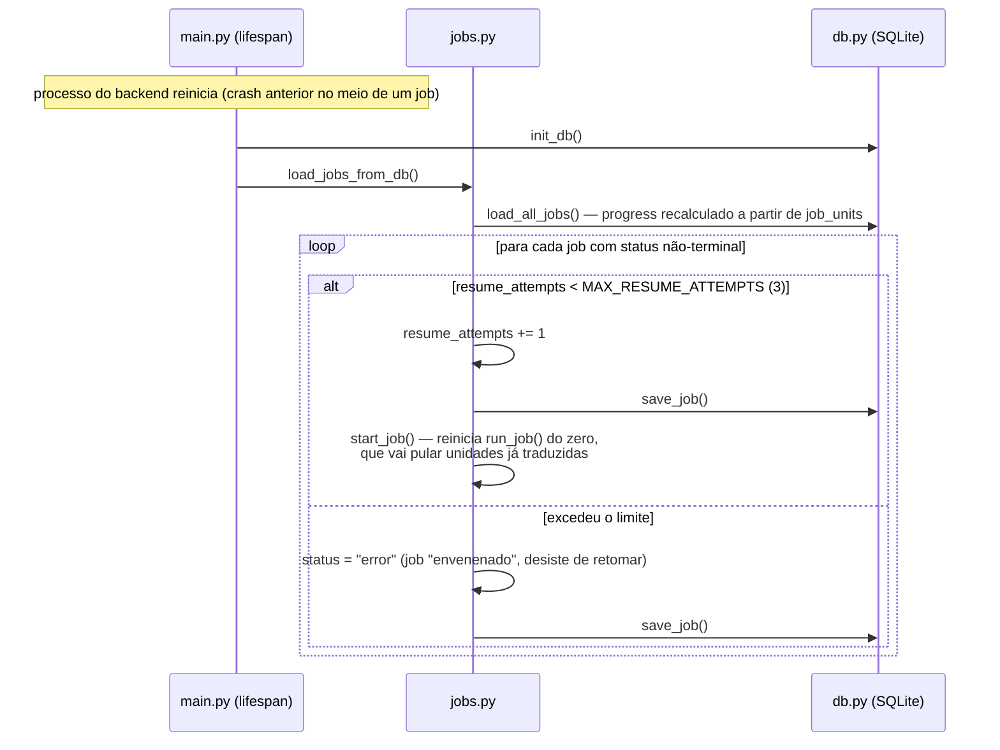
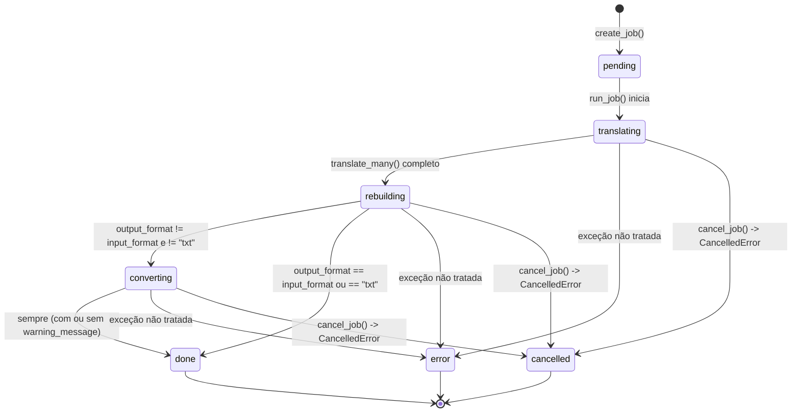

# Pipeline de Tradução

## Fluxo ponta a ponta

## Retomada automática após um crash/restart

## Máquina de estados do Job

Estados possíveis de `Job.status` (`jobs.py`): `pending`, `translating`, `rebuilding`,
`converting`, `done`, `error`, `cancelled`. O frontend (`app.js: STATUS_LABELS`) traduz cada um
para uma label em português. `error`, `done` e `cancelled` são estados terminais
(`jobs.TERMINAL_STATUSES`) — o polling do frontend para (`clearInterval`) ao atingir qualquer um
dos três, e é esse mesmo conjunto que `load_jobs_from_db()` usa para decidir quais jobs precisam
ser retomados no startup (todo o resto).

## Pontos de atenção para quem for mexer aqui

- **`run_job` roda como `asyncio.Task`, mas agora persiste estado suficiente em SQLite para
  sobreviver a um crash.** Diferente da versão anterior (só em memória), um restart do backend não
  perde progresso: `load_jobs_from_db()` retoma automaticamente qualquer job não-terminal, e
  `run_job()` pula unidades que `job_units` já mostra como traduzidas.
- **Toda exceção dentro de `run_job` vira `status="error"` com a mensagem crua da exceção**
  (`str(exc)`) exposta no frontend. Isso é intencional para uma ferramenta local de uso pessoal
  (facilita debugar), mas seria um problema de segurança/UX se isso virasse multi-usuário.
- **`progress_total` só é conhecido depois do `.load()`** (é `len(doc.units)`), então entre
  `status="translating"` e o primeiro `on_progress` callback, o frontend recebe
  `progress_total > 0` mas `progress_done == 0` — isso é esperado, não travado.
- **`progress_done` já parte de um valor maior que zero quando há retomada/cache.** `run_job`
  calcula `already_done = len(doc.units) - len(pending_indices)` antes mesmo de chamar
  `translate_many()` — se metade das unidades já estava traduzida (retomada) ou em cache, a barra
  de progresso já começa em 50%, não em 0%.
- **A tradução usa a MESMA lista `translations` em rebuild() independente do formato de saída.**
  Ou seja, o texto que sai no `.txt` de fallback (quando `output_format == "txt"`) é o texto puro
  traduzido, sem qualquer estrutura do documento original — é literalmente
  `"\n\n".join(translations)`.
- **O cache de tradução é global e permanente** (tabela `translation_cache`, chave = hash SHA-256
  do texto original). Isso significa que um texto idêntico em dois livros diferentes é traduzido
  uma vez só — bom para velocidade, mas também significa que **o cache nunca expira nem é
  invalidado automaticamente**: se o modelo do llama-server mudar (ex: trocar de `gemma-4-E2B` para
  outro modelo) e você quiser uma tradução nova para o mesmo texto, vai precisar limpar a tabela
  `translation_cache` manualmente (ou apagar `data/traduz.db`).
- **Cancelar não interrompe uma escrita SQLite em andamento.** `task.cancel()` propaga
  `asyncio.CancelledError` na próxima vez que a coroutine dá `await`; um `save_unit_translation()`
  já disparado via `asyncio.to_thread` roda até o fim (é uma operação atômica no SQLite) antes do
  cancelamento ser observado — nunca fica uma escrita pela metade.
