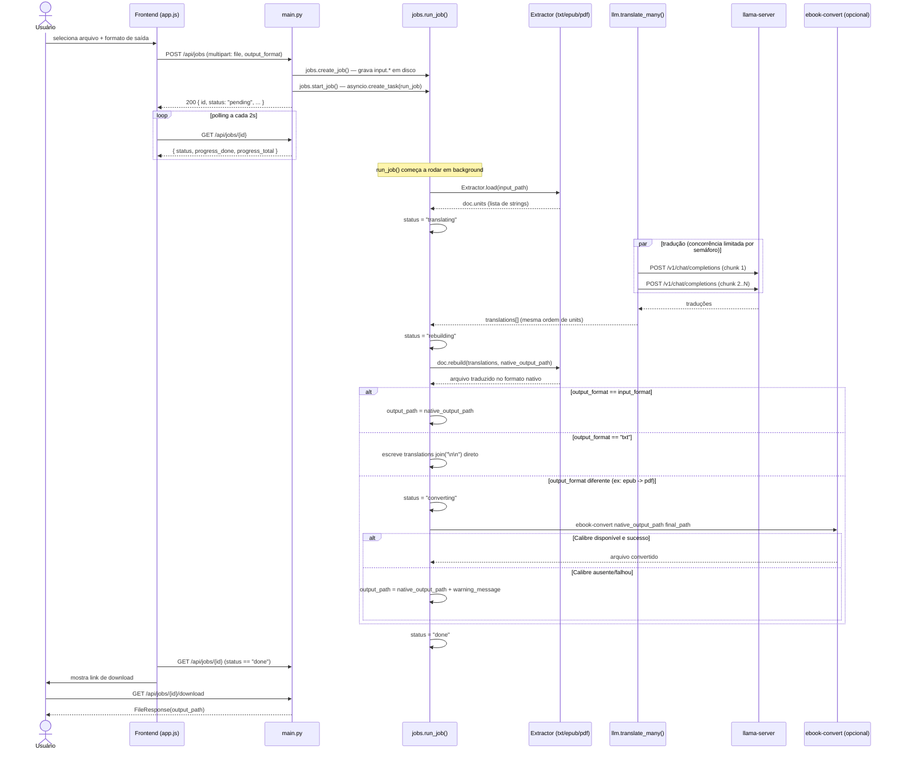
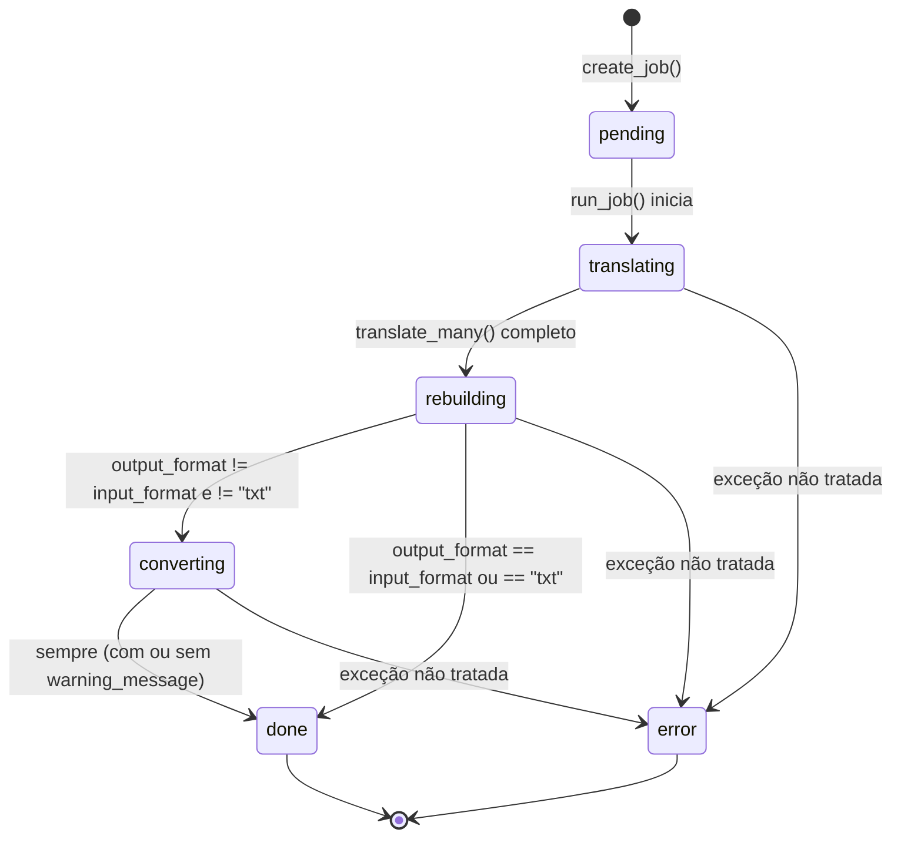

# Pipeline de Tradução

## Fluxo ponta a ponta

## Máquina de estados do Job

Estados possíveis de `Job.status` (`jobs.py`): `pending`, `translating`, `rebuilding`,
`converting`, `done`, `error`. O frontend (`app.js: STATUS_LABELS`) traduz cada um para uma label
em português. `error` e `done` são estados terminais — o polling do frontend para (`clearInterval`)
ao atingir qualquer um dos dois.

## Pontos de atenção para quem for mexer aqui

- **`run_job` é fire-and-forget** (`asyncio.create_task`, não aguardado por nada). Se o processo
  do backend morrer no meio, o job fica "translating" para sempre do ponto de vista do
  frontend (que vai continuar fazendo polling em um job_id que não existe mais depois de um
  restart, já que `JOBS` é só em memória) — o usuário vê a barra de progresso travada, sem erro
  explícito. Não há reconciliação/retomada de jobs após um restart.
- **Toda exceção dentro de `run_job` vira `status="error"` com a mensagem crua da exceção**
  (`str(exc)`) exposta no frontend. Isso é intencional para uma ferramenta local de uso pessoal
  (facilita debugar), mas seria um problema de segurança/UX se isso virasse multi-usuário.
- **`progress_total` só é conhecido depois do `.load()`** (é `len(doc.units)`), então entre
  `status="translating"` e o primeiro `on_progress` callback, o frontend recebe
  `progress_total > 0` mas `progress_done == 0` — isso é esperado, não travado.
- **A tradução usa a MESMA lista `translations` em rebuild() independente do formato de saída.**
  Ou seja, o texto que sai no `.txt` de fallback (quando `output_format == "txt"`) é o texto puro
  traduzido, sem qualquer estrutura do documento original — é literalmente
  `"\n\n".join(translations)`.
